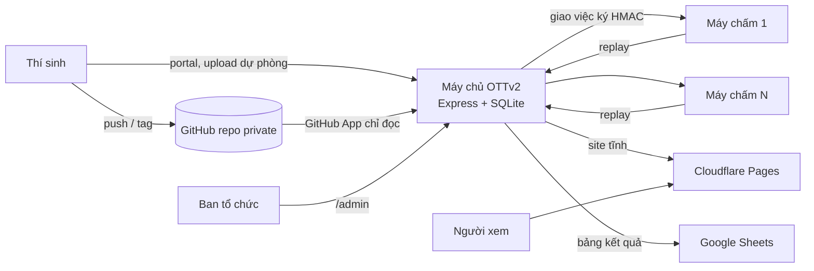
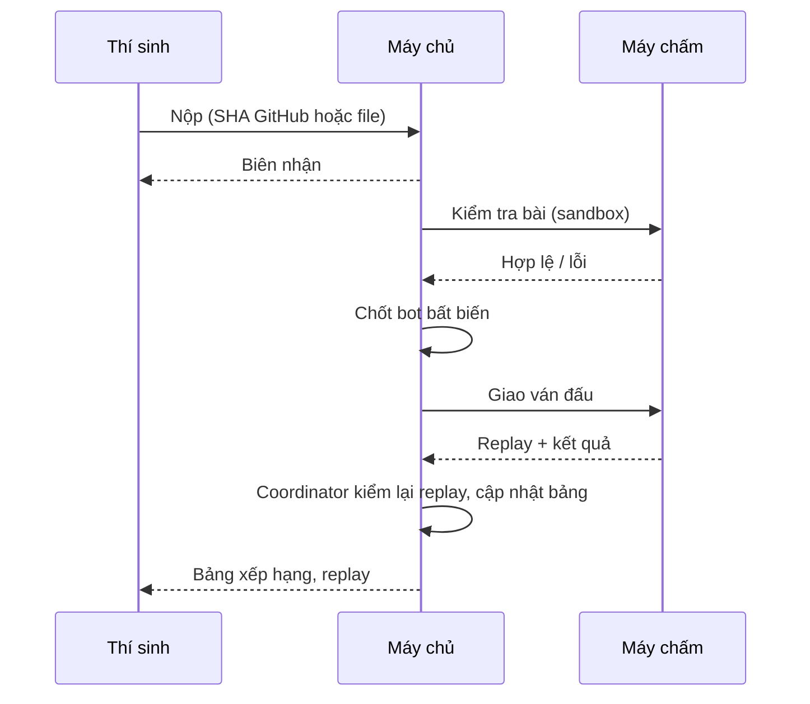
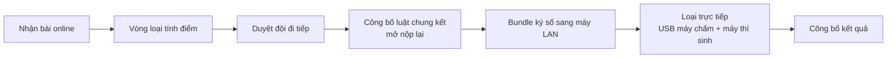

<div align="center">

# 🤖 OTTv2

### Nền tảng tổ chức giải thi đấu bot Búa · Bao · Kéo trên bàn cờ

Thí sinh viết bot Python/C++, nộp qua GitHub hoặc form upload. Máy chủ kiểm tra, chấm trong sandbox, xếp cặp, công bố kết quả. Có đủ công cụ cho chung kết LAN không cần Internet.

Cập nhật trải nghiệm: 19/10/2026. Sau đăng nhập, mở **Bắt đầu**: thí sinh có 4 bước nộp bot; ban tổ chức có lộ trình điều hành giải và phần giới thiệu cho giám khảo. Người tham gia chỉ cần tài khoản và trình duyệt; việc cài máy chủ bên dưới dành cho người vận hành.

Trong **Giải đấu**, thẻ **Việc cần làm tiếp theo** giải thích bước hiện tại; bấm **Đến phần cần thao tác** để chuyển đến vị trí tương ứng, rồi tự kiểm tra và thực hiện. Cấu hình số đội/vòng/ván được tóm tắt bên ngoài và chỉnh trong phần mở rộng.

Bài **Luyện tập ngoài giải** không phải bài dự thi. Chọn đúng giải/giai đoạn trước khi nộp, kiểm tra bản đang chọn và bản đã chốt. **Điểm ngoài giải** là luồng cũ, được thu gọn và không quyết định thứ hạng giải chính thức. Xem [rà soát trải nghiệm](docs/RA-SOAT-TRAI-NGHIEM.md) để biết phạm vi đã sửa và phần còn cần kiểm chứng.

## Chạy nhanh trên máy cá nhân


[Cài đặt và sử dụng](docs/CAI-DAT-VA-SU-DUNG.md) · [Quy tắc giải](docs/QUY-TAC-GIAI-DAU.md) · [Hướng dẫn viết bot](docs/HUONG-DAN.md) · [Sổ tay ngày thi](docs/RUNBOOK.md) · [Việc còn lại](TODO.md)

</div>

---

## 📑 Mục lục

1. [Giới thiệu](#1-giới-thiệu)
2. [Tính năng](#2-tính-năng)
3. [Công nghệ](#3-công-nghệ)
4. [Kiến trúc](#4-kiến-trúc)
5. [Cấu trúc thư mục](#5-cấu-trúc-thư-mục)
6. [Cài đặt và chạy](#6-cài-đặt-và-chạy)
7. [Các lệnh npm](#7-các-lệnh-npm)
8. [Năng lực đã đo](#8-năng-lực-đã-đo)
9. [Tài liệu](#9-tài-liệu)
10. [Đóng góp](#10-đóng-góp)

---

## 1. Giới thiệu

OTTv2 phục vụ một giải đấu bot từ đầu đến cuối:

- **Vòng loại online:** nhận bài qua GitHub, vòng tính điểm kiểu Swiss.
- **Chung kết offline:** loại trực tiếp trong phòng máy LAN, máy chấm và máy thí sinh khởi động từ USB.
- **Quy mô thiết kế:** khoảng 1.000 đội × 4 thành viên, đã đo tải bằng công cụ trong repo (xem [mục 8](#8-năng-lực-đã-đo)).
- **Lớp học:** có gói portable chạy trên máy phổ thông không có quyền quản trị.

> [!NOTE]
> Hệ thống chưa chạy một giải thật với người thật. Những việc còn thiếu trước khi tổ chức giải thật nằm trong [TODO.md](TODO.md).

---

## 2. Tính năng

### 👩‍💻 Thí sinh

| Tính năng | Mô tả |
|---|---|
| Nộp bằng GitHub | Repo private + GitHub App chỉ đọc; xác minh bằng mã trong repo; nộp theo SHA bằng nút hoặc tag; tự lấy commit lúc hết hạn |
| Nộp file dự phòng | Upload `.py`/`.cpp`/`.zip`, có biên nhận, Cloudflare Turnstile tùy chọn |
| Chạy thử tại máy | `npm run ott-run -- main.py`: báo lỗi tiếng Việt, xuất `replay.html` xem offline |
| Xem lại ván | Replay có phím tắt, nút nhảy tới pha ăn quân |
| Tra cứu kết quả | Site công khai trên Cloudflare Pages, mã tra cứu theo đội |

### 🛠️ Ban tổ chức

| Tính năng | Mô tả |
|---|---|
| Luật dữ liệu hóa | Luật có phiên bản; loại ô, ô hiệu ứng, bàn cờ khai báo bằng JSON; 3 bộ luật mẫu ([Bộ luật](docs/RULE-SETS.md)) |
| Vòng loại tính điểm | Ghép đội gần điểm, tránh gặp lại, chỉ số phụ, huy hiệu, duyệt đội đi tiếp |
| Loại trực tiếp | Miễn đấu, ván phụ đổi bên, hòa xét hạt giống; chạy tự động hoặc từng cặp |
| Đổi luật cho chung kết | Công bố luật chính thức, mở nộp lại cho đội đi tiếp, chốt bot theo luật mới |
| Máy chấm phân tán | `npm run grader` trên máy khác; việc ký HMAC, có hạn giữ, tự giao lại khi máy chết |
| USB phòng thi | USB máy chấm tự đăng ký bằng mã; USB thí sinh có tường lửa chỉ tới máy chủ |
| Chung kết LAN | Đồng bộ online ↔ LAN bằng bundle ký số; snapshot định kỳ; khôi phục sang máy dự phòng |
| Công bố kết quả | Bản công bố bất biến, site tĩnh, bản sao Google Sheets |
| Điều hành | Tạm dừng / tiếp tục / hủy, nhật ký, duyệt kết quả |

---

## 3. Công nghệ

| Lớp | Công nghệ |
|---|---|
| Máy chủ | Node.js ≥ 24, Express 5 |
| Dữ liệu | SQLite qua `node:sqlite` (WAL, migration tự động) |
| Giao diện | HTML/CSS/JS thuần, không framework, không bước build |
| Sandbox | Docker; bubblewrap + Landlock + seccomp trong WSL2/Linux; Job Object cho lớp học |
| Ngôn ngữ bot | Python 3.11, C++ (g++) |
| Nộp bài | GitHub App (chỉ đọc Contents) |
| Công bố | Cloudflare Pages, Google Sheets API |
| USB boot | Debian live, Secure Boot (shim đã ký), GRUB khóa mật khẩu |

---

## 4. Kiến trúc

### Tổng quan



### Vòng đời một bài nộp



### Từ vòng loại đến chung kết



---

## 5. Cấu trúc thư mục

```text
OTTv2/
├── server.js               # Điểm vào máy chủ
├── src/                    # Mã máy chủ
│   ├── game/               #   Luật chơi, engine, giao thức bot
│   ├── sandbox/            #   Docker, bubblewrap, Windows Job
│   ├── submissions/        #   Nhận bài, kiểm tra mã nguồn
│   ├── github/             #   GitHub App
│   ├── grader/             #   Coordinator và agent máy chấm
│   ├── publish/            #   Site tĩnh, Cloudflare Pages, Google Sheets
│   ├── sync/  backup/      #   Đồng bộ online ↔ LAN, snapshot
│   ├── usb/                #   Cấu hình USB boot
│   ├── swiss*.js           #   Vòng loại tính điểm
│   └── brackets.js …       #   Loại trực tiếp, giải, người dùng, DB
├── web/                    # Giao diện admin và portal thí sinh
├── web-public/             # Site kết quả công khai (đẩy lên Pages)
├── public/                 # Trang chơi thử, khán giả, ảnh
├── rules/                  # Bộ luật mẫu (JSON)
├── bots/                   # Bot mẫu, template, fixture kiểm thử
├── sandbox/                # Dockerfile, supervisor, rootfs Windows
├── usb/                    # Script dựng và test ảnh USB boot
├── scripts/                # CLI: seed, grader, site, sync, usb, đo tải …
├── test/                   # *.test.js (npm test) và *.integration.js
├── docs/                   # Tài liệu (xem mục 9)
├── TODO.md                 # Checklist và nhật ký tiến trình
└── AGENTS.md               # Quy ước làm việc trong repo
```

Thư mục `data/` (DB, bài nộp), `output/` (kết quả đo, ảnh chụp) và `dist/` (gói lớp học) được tạo khi chạy, không có trong Git.

---

## 6. Cài đặt và chạy

### Yêu cầu

- Node.js ≥ 24.16, npm, Git.
- Docker Linux đang chạy. Trên Windows dùng Docker Desktop/WSL2.
- Sandbox cần Landlock ABI ≥ 3, seccomp và cgroup v2. Lệnh `sandbox:check` kiểm tra các điều kiện này.

### Chạy trên máy cá nhân

```bash
git clone https://github.com/ThePlaceOfTangerine/OTTv2.git
cd OTTv2
npm ci
npm run seed
npm run sandbox:build
npm run sandbox:check
npm start
```

Mở http://127.0.0.1:3000/admin hoặc http://127.0.0.1:3000/portal.

- `seed` tạo `admin/admin` và `contestant01`–`contestant20`, mật khẩu ban đầu trùng tên đăng nhập. Thí sinh phải đổi mật khẩu ở lần đăng nhập đầu.
- Chạy `seed` lần nữa không đổi mật khẩu tài khoản đã có.
- Những lần sau chỉ cần mở Docker rồi `npm start`.

> [!WARNING]
> Tài khoản mặc định chỉ dùng trên máy cá nhân. Trước khi mở ra Internet, đổi mật khẩu admin và đặt máy chủ sau HTTPS. Xem [Triển khai](docs/DEPLOYMENT.md).

### Phòng máy trường phổ thông

Dùng gói `OTTv2-lop-hoc.zip` (tạo bằng `npm run package:classroom`). Giải nén vào thư mục **không dấu**, bấm đúp `start.bat`, làm theo trang cài đặt lần đầu. Gói có sẵn Node và Python 3.11; thêm C++ bằng `OTTv2-add-cpp.zip`. Xem [Gói lớp học](docs/LOP-HOC.md).

### Kết nối dịch vụ ngoài (tùy chọn)

`scripts/start-server.ps1` đọc khóa Cloudflare, Google và GitHub App từ một thư mục **nằm ngoài repo**, đặt biến môi trường rồi chạy `npm start`. Cách tạo từng khóa: [Công bố](docs/PUBLISHING.md), [GitHub](docs/GITHUB.md).

---

## 7. Các lệnh npm

| Nhóm | Lệnh | Việc làm |
|---|---|---|
| Chạy | `start`, `seed`, `seed:bots` | Máy chủ; tài khoản mẫu; bot mẫu |
| Sandbox | `sandbox:build`, `sandbox:check` | Dựng image; kiểm tra điều kiện bảo mật |
| Máy chấm | `grader` | Chạy agent máy chấm trên máy khác |
| Thí sinh | `ott-run -- main.py` | Chạy thử bot, xuất replay offline |
| Công bố | `site:build`, `site:deploy` | Dựng site tĩnh; đẩy lên Cloudflare Pages |
| LAN | `sync`, `import:folder`, `restore`, `offline:check` | Bundle online ↔ LAN; nhập bài từ USB; khôi phục snapshot; kiểm tra chạy không Internet |
| Đóng gói | `package:classroom`, `usb:config`, `usb:build`, `usb:test` | Gói lớp học; cấu hình, dựng và test ảnh USB |
| Kiểm thử | `test` | Unit và API (không cần Docker) |
| | `test:stages`, `test:sandbox`, `test:pipeline`, `test:bwrap`, `test:grader`, `test:recovery` … | Kiểm thử tích hợp, cần Docker hoặc WSL |

Danh sách đầy đủ trong [package.json](package.json).

---

## 8. Năng lực đã đo

Đo ngày 20–21/10/2026 trên một máy. Chi tiết và giới hạn của cách đo trong [CAPACITY.md](docs/CAPACITY.md).

| Kịch bản | Kết quả |
|---|---|
| 1.000 đội nộp bài, xem bảng xếp hạng, 8.000 ván | 0 lỗi; biên nhận p95 1,0 s; bảng xếp hạng p95 0,29 s |
| Ván thật trong bubblewrap | ~1,6 giây-slot mỗi ván; ~5,2 giây-slot mỗi lần kiểm tra bài |
| Site công khai trên Cloudflare Pages, 4.000 request | p95 0,13–0,17 s, không có lỗi HTTP |
| USB boot | Qua test UEFI Secure Boot và BIOS, kể cả khóa GRUB (máy ảo) |

---

## 9. Tài liệu

| Bạn là | Đọc |
|---|---|
| Người mới tải dự án | [Cài đặt và sử dụng](docs/CAI-DAT-VA-SU-DUNG.md) |
| Thí sinh | [Hướng dẫn viết bot](docs/HUONG-DAN.md) · [Giao thức](docs/PROTOCOL.md) · [Bộ luật](docs/RULE-SETS.md) · [Nộp bằng GitHub](docs/GITHUB.md) |
| Ban tổ chức | [Quy tắc giải](docs/QUY-TAC-GIAI-DAU.md) · [Quản lý giải](docs/TOURNAMENTS.md) · [Vòng loại](docs/SWISS.md) · [Loại trực tiếp](docs/BRACKETS.md) · [Luật chính thức](docs/FINAL-RULES.md) · [Nhận bài mới](docs/FINAL-INTAKE.md) |
| Điều hành giải lớn | [Thể thức](docs/FORMAT.md) · [Thông báo mẫu](docs/ANNOUNCEMENT.md) · [Phân vai](docs/RACI.md) · [Rủi ro](docs/RISKS.md) · [Sổ tay ngày thi](docs/RUNBOOK.md) |
| Kỹ thuật vận hành | [Máy chấm](docs/GRADERS.md) · [USB boot](docs/USB-BOOT.md) · [Công bố kết quả](docs/PUBLISHING.md) · [Triển khai](docs/DEPLOYMENT.md) · [Năng lực](docs/CAPACITY.md) · [Red team](docs/RED-TEAM.md) |
| Giáo viên | [Gói lớp học](docs/LOP-HOC.md) · [Giải thử 6 đội](docs/DEMO-6-TEAMS.md) |
| Người duyệt yêu cầu | [Yêu cầu giải](docs/TOURNAMENT-REQUIREMENTS.md) · [TODO](TODO.md) |

---

## 10. Đóng góp

- Đọc [AGENTS.md](AGENTS.md) và [TODO.md](TODO.md) trước khi sửa.
- Chạy `npm test` trước khi commit. Phần sandbox chạy thêm `npm run test:sandbox` hoặc `npm run test:bwrap`.
- Đổi cách cài, chạy hoặc biến môi trường: cập nhật [Cài đặt và sử dụng](docs/CAI-DAT-VA-SU-DUNG.md) và README trong cùng đợt.
- Sửa quy tắc giải: cập nhật [QUY-TAC-GIAI-DAU.md](docs/QUY-TAC-GIAI-DAU.md) rồi chạy `node scripts/build-tournament-guide.js`.
- Sao lưu `data/` trước khi cập nhật. SQLite tự migration khi khởi động.
- Không commit `data/`, `.env`, khóa bí mật hay dữ liệu thí sinh thật. Giữ `package-lock.json`, cài bằng `npm ci`.

<div align="center">

<sub>OTTv2 · Cập nhật 21/10/2026</sub>

Đăng nhập sai được giới hạn trong cửa sổ 15 phút: mặc định 10 lượt/tài khoản và 100 lượt/IP. Đăng nhập đúng hoàn lại lượt của chính yêu cầu đó; các lần sai trước vẫn được giữ. Khi gặp HTTP 429, nút đăng nhập đếm ngược theo `Retry-After` rồi cho thử lại, không tự gửi lại mật khẩu.

Proxy mặc định tắt. Khi dùng reverse proxy, đặt `TRUSTED_PROXIES` theo IP/CIDR của proxy, `PUBLIC_ORIGIN` theo địa chỉ website; HTTPS cần `COOKIE_SECURE=true`. Giới hạn đăng nhập lấy IP qua chuỗi proxy tin cậy và Origin được đối chiếu với địa chỉ cố định. Xem [cấu hình proxy](docs/DEPLOYMENT.md); chưa nghiệm thu cấu hình Nginx/Cloudflare thật.

- npm test: unit/API; npm run test:stages: luồng giải bằng Docker. Các lệnh khác nằm trong package.json.
- Sao lưu data/ và phiên bản mã/image trước cập nhật. SQLite tự migration khi khởi động; DB cần đi cùng artifact trong data/submissions.
- Git không chứa data/, node_modules, .env, khóa bí mật hoặc kết quả thử cục bộ. Giữ package-lock.json và dùng npm ci.
- Khi đổi cách cài/chạy hoặc hành vi sử dụng, cập nhật hướng dẫn người dùng, README và TODO trong cùng đợt. Sửa quy tắc giải thì dựng lại trang admin bằng node scripts/build-tournament-guide.js.

</div>

Cập nhật 21/10/2026: trong Giải đấu, mục Công bố kết quả công khai xuất hiện theo giải đang chọn, kể cả giải vừa tạo. Sau khi công bố, khách xem bảng điểm và replay tại `/site/` (hoặc địa chỉ do ban tổ chức cung cấp), không cần tài khoản quản trị. Trình sửa bàn cờ giữ focus tại ô vừa chỉnh khi dùng bàn phím.

Power-up (21/10/2026): Bộ luật → Cách đặt power-up cho chọn ngẫu nhiên trên toàn bàn hoặc admin tự đặt từng vị trí. Luật mẫu OTTv2 Power-ups bản 2 rải 2–4 ô; nhà, vị trí xuất phát, ô chặn và ô ngoài bản đồ được loại trừ. Lưu tạo phiên bản mới, không đổi luật đã ghim của giải cũ.

Cập nhật bộ luật 21/10/2026: Classic có 5 công cụ cơ bản; Obstacles thêm Ô chặn (gộp Tường đá); Power-ups có số lượng random tối thiểu/tối đa hoặc đặt từng ô. Có nút Xóa bộ luật riêng, giữ ba mẫu mặc định và lịch sử giải/replay. Xem docs/RULE-SETS.md.
